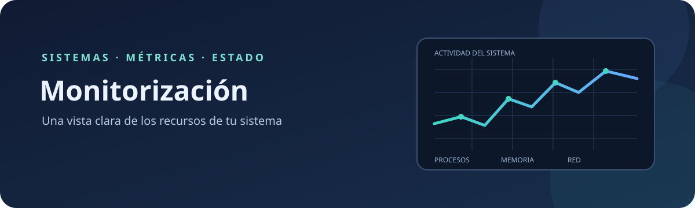

# Monitorización

Material de referencia y prácticas sobre la monitorización de sistemas y sus
recursos.

## Contenidos

| Tema | Descripción |
| --- | --- |
| [**Procesos**](procesos/README.md) | Seguimiento de procesos y de su actividad. |
| [**Memoria y disco**](memoria-y-disco/README.md) | Uso de memoria, espacio de almacenamiento y rendimiento del disco. |
| [**Red**](red/README.md) | Supervisión del tráfico y la actividad de red. |

## Estado

En desarrollo. Los contenidos se irán añadiendo progresivamente.