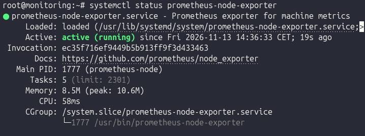
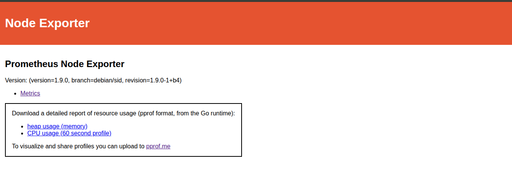
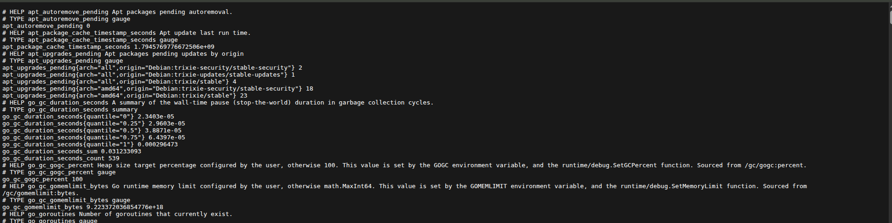
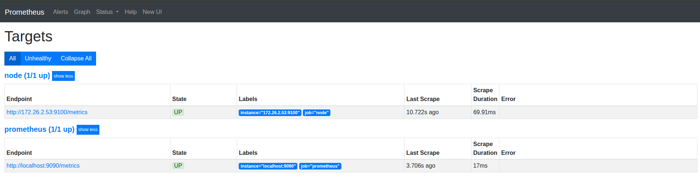
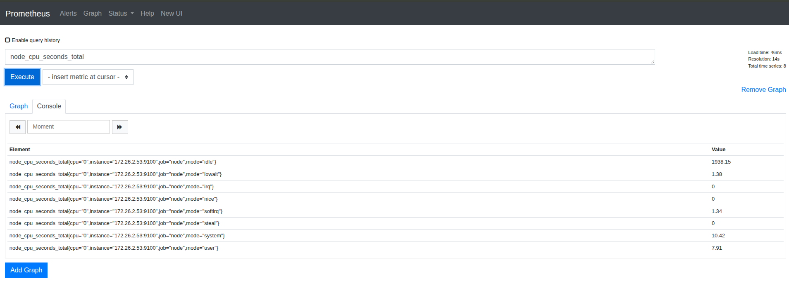
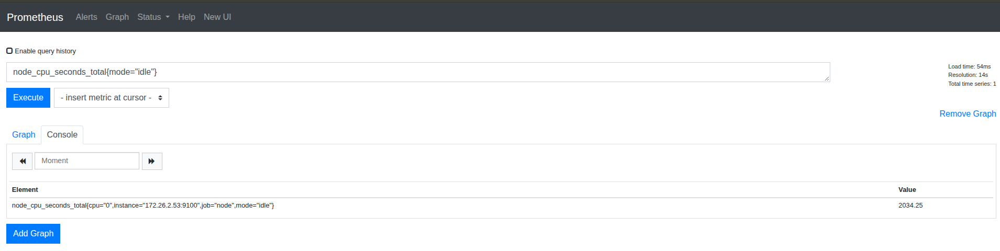
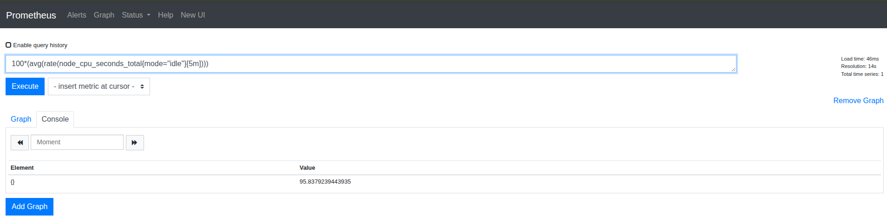

# 1. Instalación de Prometheus y Node Exporter

Esta guía instala Prometheus y Node Exporter en Debian o Ubuntu. Node Exporter
expone métricas del sistema para que Prometheus pueda recopilarlas.

## Instalación

```bash
sudo apt update
sudo apt install -y prometheus prometheus-node-exporter
sudo systemctl enable --now prometheus prometheus-node-exporter
```

Comprueba que Node Exporter está activo:

```bash
systemctl status prometheus-node-exporter
```



Abre `http://localhost:9100` para comprobar que Node Exporter responde:



Selecciona **Metrics** para consultar las métricas que expone:



## Configuración de Prometheus

En `/etc/prometheus/prometheus.yml`, añade el siguiente trabajo dentro de la
sección `scrape_configs`, sin eliminar los trabajos que ya existan:

```yaml
  - job_name: "node"
    static_configs:
      - targets: ["localhost:9100"]
```

## Comprobaciones

Instala `yamllint` y valida la sintaxis y el formato del archivo YAML:

```bash
sudo apt install -y yamllint
sudo yamllint /etc/prometheus/prometheus.yml
```

Reinicia Prometheus para aplicar el cambio:

```bash
sudo systemctl restart prometheus
```

Abre `http://localhost:9090/targets` y comprueba que los objetivos aparecen
con estado **UP**. Prometheus escucha por defecto en el puerto `9090` y Node
Exporter en el `9100`.



En Prometheus, consulta `node_cpu_seconds_total` para comprobar que Node
Exporter también expone métricas de CPU:



La etiqueta `mode` permite consultar el tiempo acumulado de CPU en cada modo.
Por ejemplo, esta consulta muestra el tiempo en modo inactivo:

```promql
node_cpu_seconds_total{mode="idle"}
```



Para calcular el porcentaje medio de CPU inactiva durante los últimos cinco
minutos, usa `rate` sobre esa métrica:

```promql
100 * avg(rate(node_cpu_seconds_total{mode="idle"}[5m]))
```

El porcentaje de uso medio de CPU se obtiene restando ese resultado a 100:

```promql
100 - 100 * avg(rate(node_cpu_seconds_total{mode="idle"}[5m]))
```


