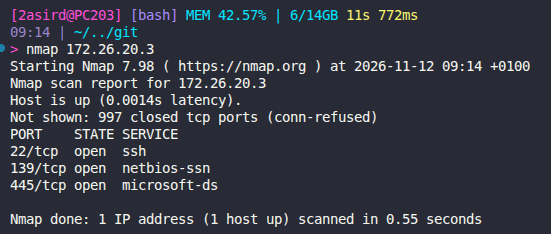

# Ejercicio práctico: análisis de una red local con ARP y Nmap

**Módulo:** Herramientas y técnicas DevOps  
**Unidad:** U3. Monitorización  
**Alumno/a:** David López Pizano  
**Fecha:** 12/11/2026

> Realiza los escaneos únicamente en la red del aula y sobre los equipos
> autorizados por el profesor. Sustituye los datos entre corchetes por los
> valores que te proporcione el profesor.

## 1. Identificar la configuración de red

Consulta la configuración de red de tu equipo y completa:

1. **Interfaz de red utilizada:** eno1
2. **Dirección IPv4 de tu equipo:** 172.26.19.189
3. **Puerta de enlace predeterminada:** 172.26.0.1
4. **Dirección de red y prefijo o máscara:** 172.26.0.0/16


## 2. Analizar y renovar una entrada ARP

### 2.1 Comprobar la red del profesor

**Dirección IPv4 del equipo del profesor:** 172.26.20.3

### 2.2 Consultar la caché ARP

Ejecuta cada comando e indica qué información muestra:

```bash
arp -a
```


```bash
arp -n
```


```bash
ip neigh
```


1. **¿Qué muestra `arp -a`?** Muestra las entradas de la caché ARP: las
   direcciones IPv4 conocidas y sus direcciones MAC asociadas, agrupadas por
   interfaz. Puede resolver las direcciones a nombres de equipo.
2. **¿Qué muestra `arp -n` y qué diferencia tiene con `arp -a`?** Muestra las mismas entradas, pero en formato numérico, sin intentar resolver las direcciones a nombres.
3. **¿Qué información muestra `ip neigh`?** Muestra la tabla de vecinos del equipo: direcciones IP, direcciones MAC conocidas, interfaz de red y estado de cada asociación (por ejemplo, `REACHABLE`, `STALE` o `FAILED`). Puede incluir vecinos IPv4 e IPv6.
4. **¿Qué dirección MAC aparece asociada a la puerta de enlace?** 64:62:66:25:50:b0
5. **¿Por qué la tabla ARP no muestra necesariamente todos los equipos de la red?**
   La tabla ARP es una caché local y dinámica: normalmente contiene solo los
   equipos con los que el equipo ha intercambiado tráfico recientemente o
   necesita comunicarse. Las entradas caducan y ARP solo resuelve direcciones
   IPv4 de la red local; no es un listado de todos los equipos conectados.

### 2.3 Crear y consultar la entrada del profesor

Haz ping al equipo del profesor y consulta su entrada en la tabla de vecinos:

```bash
ping -c 2 172.26.20.3
ip neigh show 172.26.20.3
```

**¿Qué dirección MAC aparece asociada a la IP del profesor?**

**Respuesta:** f4:b5:20:40:51:a6

### 2.4 Eliminar y regenerar la entrada

Elimina únicamente la asociación del equipo del profesor. Sustituye
`[IP_PROFESOR]` y `[INTERFAZ]` por los valores correspondientes. Ejecuta el
segundo comando inmediatamente después del primero:

```bash
ip neigh del 172.26.20.3 dev eno1
ip neigh show 172.26.20.3
```

**¿Qué resultado devuelve la consulta después de eliminar la entrada?**

**Respuesta:** Si la eliminación se ha realizado correctamente, `ip neigh show
[IP_PROFESOR]` no muestra ninguna entrada para esa IP. Si el equipo vuelve a
comunicarse con el profesor, el sistema puede crear la entrada de nuevo.

Si la entrada no se genera automáticamente, vuelve a hacer ping y consúltala:

## 3. Descubrir equipos con Nmap

Escanea el rango de la red del aula indicado en la práctica, usando `-sn` para
descubrir equipos sin escanear sus puertos:

```bash
nmap -sn 172.26.20.0/24
```

1. **¿Qué hace exactamente la opción `-sn`?** Dice si el equipo está activo.
2. **¿Cuántos equipos aparecen como activos y cuáles son sus direcciones IP?**
  Aparecen 2 equipos activos.


## 4. Examinar puertos y servicios

Escanea exclusivamente la máquina objetivo que indique el profesor. Sustituye
`[IP_OBJETIVO]` por esa dirección:

```bash
nmap 172.26.20.3
```



```bash
nmap -sV 172.26.20.3
```

1. **¿Qué puertos aparecen abiertos en el primer escaneo?** 22 139 445
2. **¿Qué información adicional aparece en el segundo escaneo?** Las versiones de los servicios
3. **¿Qué hace la opción `-sV`?** Envía sondas a los puertos abiertos para
   identificar los servicios que se ejecutan en ellos y, cuando es posible,
   determinar sus versiones.

