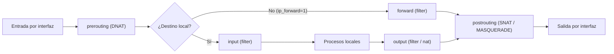

# Cortafuegos y NAT en Linux con `nftables`

Documentación completa sobre filtrado de paquetes, traducción de direcciones
(NAT) y depuración de redes en Linux mediante **`nftables`**, orientada a la
administración segura de servidores y routers perimetrales.

## Diagrama de recorrido de paquetes en Netfilter

## Contenidos

| Documento | Qué cubre |
| --- | --- |
| [1. Fundamentos de Netfilter, caminos y NAT](01-fundamentos-netfilter-y-nat.md) | Arquitectura Netfilter/`nftables`, flujos `INPUT`/`OUTPUT`/`FORWARD`, `ip_forward`, `conntrack` y tipos de NAT (`SNAT`, `MASQUERADE`, `DNAT`). |
| [2. Arquitectura y sintaxis de `nftables`](02-arquitectura-y-sintaxis-nftables.md) | Familias (`inet`, `ip`, `ip6`), tablas, cadenas base y regulares, prioridades, veredictos, interfaces (`iif` vs `iifname`), `set`, `map` y `limit rate`. |
| [3. Plantillas y escenarios de configuración](03-plantillas-y-escenarios.md) | Recarga atómica con `/etc/nftables.conf`, cortafuegos de servidor, router con `MASQUERADE` y `DNAT`, y comparativa entre doble NAT y enrutamiento puro. |
| [4. Gestión, equivalencias y depuración](04-gestion-depuracion-y-equivalencias.md) | Validación (`nft -c -f`), gestión por `handle`, truco anti-bloqueo SSH, equivalencias con `iptables` y diagnóstico con `counter`, `journalctl`, `tcpdump` y `conntrack`. |
| [5. Errores frecuentes y ejercicios de repaso](05-errores-frecuentes-y-autoevaluacion.md) | Fallos típicos de configuración y examen, lista de comprobación previa al despliegue y supuestos prácticos resueltos. |

## Plantillas de ejemplo

- [Servidor básico con familia `inet`](ejemplos/servidor-basico.nft)
- [Router con `MASQUERADE` y redirección `DNAT`](ejemplos/router-nat-dnat.nft)

## Recorrido recomendado

1. Empieza por los [fundamentos de Netfilter y NAT](01-fundamentos-netfilter-y-nat.md)
   para dominar el recorrido de los paquetes y los estados de conexión.
2. Continúa con la [arquitectura y sintaxis](02-arquitectura-y-sintaxis-nftables.md)
   para comprender tablas, hooks, prioridades y estructuras avanzadas.
3. Estudia los [escenarios y plantillas](03-plantillas-y-escenarios.md) y adapta
   los ficheros de [`ejemplos/`](ejemplos/).
4. Practica los comandos de [gestión y depuración](04-gestion-depuracion-y-equivalencias.md).
5. Repasa los [errores frecuentes y ejercicios](05-errores-frecuentes-y-autoevaluacion.md)
   antes de pruebas prácticas o exámenes.
