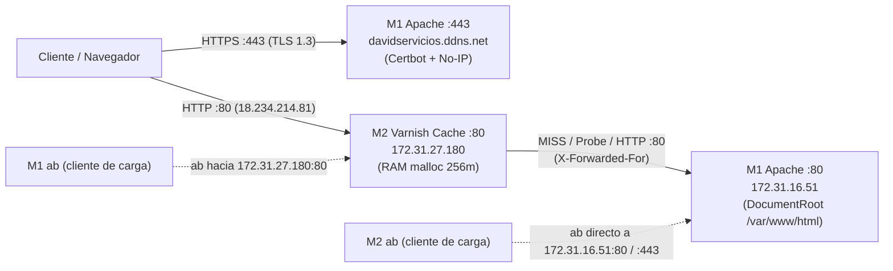

# 1. Fundamentos y arquitectura

**Navegación:** [Inicio](../README.md) ·
[Siguiente: Requisitos e instalación →](02-requisitos-e-instalacion.md)

## 1.1 Objetivo y alcance

### Objetivo
Desplegar, asegurar, acelerar y validar un servicio web distribuido entre **dos instancias AWS EC2** con **Debian 13 (`trixie`)**, aplicando los criterios del **RA3 (Servidores web)**:
- Servir el sitio web estático/SPA publicado en `/var/www/html` con **Apache HTTP Server 2.4** y **HTTPS** mediante certificado **Let's Encrypt (Certbot)** sobre el dominio dinámico **`davidservicios.ddns.net`** (actualizado por **`noip-duc`**).
- Desplegar **Varnish Cache 7.7** en la segunda instancia como **proxy caché HTTP** delante del backend Apache para absorber lecturas en memoria RAM (`malloc,256m`) y monitorizar la salud del origen.
- Ejecutar pruebas de rendimiento y carga reproducibles con **ApacheBench (`ab`)** desde una máquina distinta a la evaluada para comparar el comportamiento directo contra Apache (HTTP y HTTPS) frente a Varnish Cache.

### Alcance (qué cubre y qué no cubre)
- **Cubre:** servicio HTTP/HTTPS en puertos `80` y `443`, cabeceras de caché (`Cache-Control`, `Expires`), restauración de IP cliente (`mod_remoteip`), estado interno (`mod_status`), caché e invalidación (`PURGE`) en Varnish y pruebas `ab`.
- **No cubre:** balanceo multipunto con HAProxy/Nginx para terminación TLS delante de Varnish (en AWS los Security Groups entre ambas instancias solo permiten `22`, `80` y `443`), WAF/ModSecurity ni base de datos.

---

## 1.2 Fundamentos HTTP, caché y TLS aplicados (RA3 §1 y §7.3)

- **Modelo petición-respuesta y estado:** HTTP es un protocolo sin estado; cada petición incluye método, ruta y cabecera `Host` (obligatoria en HTTP/1.1, RFC 9112, para el alojamiento virtual por nombre).
- **Versiones y rendimiento:** HTTP/1.1 usa conexiones persistentes (*keep-alive*); TLS 1.3 cifra el transporte e introduce coste de negociación (*handshake*) que se observa claramente en las pruebas con `ab`.
- **Cabeceras relevantes en este despliegue:**
  - *Petición:* `Host`, `X-Forwarded-For` (añadida por Varnish hacia Apache).
  - *Respuesta:* `Server: Apache` (endurecida con `ServerTokens Prod`), `Cache-Control: public, max-age=120`, `Expires`, `X-Varnish`, `Age`, `X-Cache` (`HIT`/`MISS`) y `X-Cache-Hits`.
- **Proxy caché HTTP (Varnish) frente a TLS:** Varnish **no habla TLS de forma nativa**. Por ello:
  - El tráfico público HTTPS de **`https://davidservicios.ddns.net`** termina directamente en Apache (`M1:443`) usando los certificados de Certbot y SNI.
  - El tráfico HTTP cacheado entra por **`M2:80`** (Varnish), que consulta al backend Apache en **`M1:80`** (`172.31.16.51:80`) cuando hay `MISS` o vence el TTL.

---

## 1.3 Topología y diagrama de arquitectura

Las dos instancias comparten la misma subred VPC (`172.31.16.0/20`) en AWS `us-east-1` y tienen los **Security Groups** abiertos entre sí exclusivamente en los puertos **`22`**, **`80`** y **`443`** (los puertos `8080` y `6081` están bloqueados entre nodos desde la VPC, lo cual condiciona la elección de puertos).

### Inventario de máquinas, interfaces y puertos

| Parámetro | Máquina 1 (`web-apache`) | Máquina 2 (`varnish-cache`) |
| :--- | :--- | :--- |
| **DNS AWS** | `ec2-13-218-219-237.compute-1.amazonaws.com` | `ec2-18-234-214-81.compute-1.amazonaws.com` |
| **Dominio DDNS** | `davidservicios.ddns.net` (No-IP `noip-duc`) | — |
| **IP privada VPC** | `172.31.16.51/20` (`ens5`) | `172.31.27.180/20` (`ens5`) |
| **Rol principal** | Servidor web Apache (backend + HTTPS) y generador `ab` | Proxy caché Varnish (`:80`) y generador `ab` |
| **Apache (`apache2`)** | Puertos `:80` (HTTP backend / redirect DDNS) y `:443` (HTTPS) | Reubicado a `:8080` (servicio local de respaldo) |
| **Varnish (`varnishd`)** | No instalado | Escucha en `:80` (público/VPC) y `127.0.0.1:6081` (`-T localhost:6082`) |
| **Acceso SSH** | `admin@ec2-13-218-219-237.compute-1.amazonaws.com` | `admin@ec2-18-234-214-81.compute-1.amazonaws.com` |

### Flujo de peticiones

1. **Petición HTTPS pública (`https://davidservicios.ddns.net/`):** el cliente resuelve por No-IP a `13.218.219.237`, negocia TLS 1.3 en `M1:443` (Certbot) y Apache entrega `/var/www/html` con `Cache-Control: public, max-age=120`.
2. **Petición HTTP pública (`http://davidservicios.ddns.net/`):** `davidservicios.conf` en `M1:80` comprueba `%{SERVER_NAME} = davidservicios.ddns.net` y redirige `301` hacia `https://davidservicios.ddns.net/`.
3. **Petición HTTP a través de Varnish (`http://18.234.214.81/` o `http://172.31.27.180/`):**
   - Entra en **Varnish (`M2:80`)**.
   - Si el objeto está en memoria (`HIT`), Varnish responde al instante con `X-Cache: HIT` sin contactar con `M1`.
   - Si no está (`MISS`) o el TTL ha expirado, Varnish solicita el recurso por la red privada a **`172.31.16.51:80`** (`apache_m1`), lo almacena en RAM (`256 MiB`) y lo devuelve con `X-Cache: MISS`.
   - En paralelo, la sonda `.probe` de Varnish consulta `GET /` cada 5 s para vigilar que `M1` está `healthy`.
