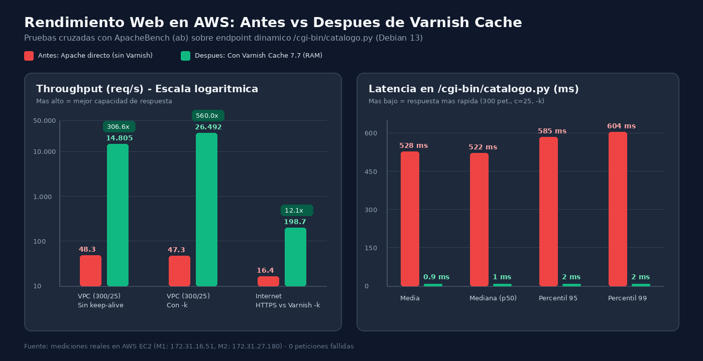
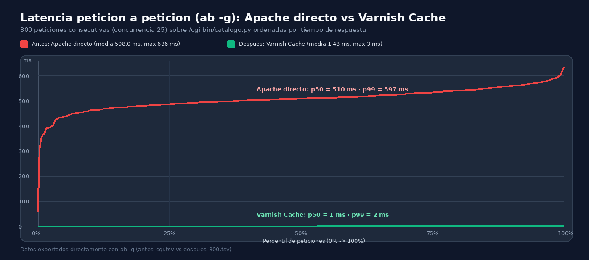

# 4. Pruebas de verificación y rendimiento con `ab`

**Navegación:** [Inicio](../README.md) ·
[← Configuración de Apache y Varnish](03-configuracion-apache-y-varnish.md) ·
[Siguiente: Operación, registros e incidencias →](05-operacion-registros-e-incidencias.md)

Todas las pruebas descritas en este documento se ejecutaron sobre el entorno real desplegado el `2026-11-18`, siguiendo el método del **RA3 §8.3**: lanzar el generador de carga (`ab`) siempre **desde una máquina distinta a la evaluada** y cambiar una sola variable cada vez.

---

## 4.1 Verificación funcional del backend, caché y `PURGE`

### Estado del backend en Varnish (`M2`)

```bash
sudo varnishadm backend.list
```

Salida observada:

```text
Backend name     Admin   Probe   Health    Last change
boot.apache_m1   probe   5/5     healthy   Wed, 18 Nov 2026 08:30:37 GMT
```

### Ciclo `MISS` → `HIT` e invalidación `PURGE` desde `M1`

```bash
curl -sI -X PURGE http://172.31.27.180/cgi-bin/catalogo.py
curl -sI http://172.31.27.180/cgi-bin/catalogo.py | grep -iE 'HTTP/|X-Cache|Age:|X-Varnish:'
curl -sI http://172.31.27.180/cgi-bin/catalogo.py | grep -iE 'HTTP/|X-Cache|Age:|X-Varnish:'
```

Resultado real:

```http
HTTP/1.1 200 Purged
Date: Wed, 18 Nov 2026 08:40:12 GMT
Server: Varnish

# Primera petición tras PURGE:
HTTP/1.1 200 OK
X-Varnish: 2457704
Age: 0
X-Cache: MISS
X-Cache-Hits: 0

# Segunda petición (servida desde RAM de Varnish):
HTTP/1.1 200 OK
X-Varnish: 2228329 2457705
Age: 0
X-Cache: HIT
X-Cache-Hits: 1
```

### Comprobación de seguridad en `PURGE` y HTTPS público

```bash
# Desde IP externa no incluida en purge_acl:
curl -sI -X PURGE http://18.234.214.81/
# HTTP/1.1 405 Method Not Allowed

# Comprobación HTTPS en M1:
curl -sI https://davidservicios.ddns.net/ | grep -iE 'HTTP/|Server:|Cache-Control:|Expires:'
# HTTP/1.1 200 OK
# Server: Apache
# Cache-Control: public, max-age=120
```

---

## 4.2 Pruebas Antes vs Después (demostración de mejora con Varnish)

Para evaluar el impacto real de Varnish Cache frente a un origen dinámico, se habilitó `mod_cgid` en `M1` con el endpoint [`catalogo.py`](../config/apache-m1/catalogo.py) (`11 989 bytes` JSON, `Cache-Control: public, max-age=120` y un retardo de `25 ms` simulando consulta a base de datos).



### A. Red interna VPC (misma carga `ab -n 300 -c 25` sobre `/cgi-bin/catalogo.py`)

```bash
# ANTES (desde M2 directo contra Apache M1):
ab -n 300 -c 25 -g /tmp/antes_cgi.tsv http://172.31.16.51/cgi-bin/catalogo.py
ab -n 300 -c 25 -k -g /tmp/antes_cgi_k.tsv http://172.31.16.51/cgi-bin/catalogo.py

# DESPUÉS (desde M1 contra Varnish M2):
ab -n 300 -c 25 -g /tmp/despues_300.tsv http://172.31.27.180/cgi-bin/catalogo.py
ab -n 300 -c 25 -k -g /tmp/despues_300_k.tsv http://172.31.27.180/cgi-bin/catalogo.py
ab -n 2000 -c 50 -k -g /tmp/despues_2000_k.tsv http://172.31.27.180/cgi-bin/catalogo.py
```

| Escenario | Carga | Keep-Alive | Tiempo total (`s`) | Throughput (`req/s`) | Media (`ms`) | `p50` (`ms`) | `p95` (`ms`) | `p99` (`ms`) | Mejora |
| :--- | :---: | :---: | ---: | ---: | ---: | ---: | ---: | ---: | :---: |
| **Antes — Apache CGI directo** | `300 / 25` | No | `6.213` | `48.29` | `517.75` | `510` | `574` | `602` | Base (`1x`) |
| **Después — Varnish Cache** | `300 / 25` | No | `0.020` | `14804.58` | `1.69` | `1` | `2` | `2` | **`306.6x`** |
| **Antes — Apache CGI directo** | `300 / 25` | Sí (`-k`) | `6.342` | `47.31` | `528.48` | `522` | `585` | `604` | Base (`1x`) |
| **Después — Varnish Cache** | `300 / 25` | Sí (`-k`) | `0.011` | `26492.41` | `0.94` | `1` | `2` | `2` | **`560.0x`** |
| **Después — Estrés Varnish** | `2000 / 50` | Sí (`-k`) | `0.060` | `33185.11` | `1.51` | `1` | `2` | `4` | **`0` fallos** |

### B. Curva de latencia petición a petición (`ab -g`)

Exportando los tiempos individuales con `ab -g` se observa la estabilidad de la caché en RAM (`1–3 ms`) frente a la cola de ejecución en el backend (`57–636 ms`):



### C. Desde cliente externo por Internet (mismo origen $\rightarrow$ IP pública AWS)

```bash
# ANTES — Estático raíz por HTTPS directo a M1:
ab -n 300 -c 30 https://davidservicios.ddns.net/
# DESPUÉS — Estático raíz por Varnish HTTP en M2 (-k):
ab -n 300 -c 30 -k http://18.234.214.81/

# ANTES — Dinámico /cgi-bin/catalogo.py por HTTPS directo a M1:
ab -n 100 -c 10 https://davidservicios.ddns.net/cgi-bin/catalogo.py
# DESPUÉS — Dinámico /cgi-bin/catalogo.py por Varnish HTTP en M2 (-k):
ab -n 300 -c 30 -k http://18.234.214.81/cgi-bin/catalogo.py
```

| Recurso (desde Internet) | Antes (`HTTPS M1`) | Después (`Varnish M2 -k`) | Mejora |
| :--- | :--- | :--- | :---: |
| **`/` (web estática)** | `47.79 req/s` (`p50 = 572 ms`) | `186.74 req/s` (`p50 = 109 ms`) | **`3.91x`** |
| **`/cgi-bin/catalogo.py`** | `16.43 req/s` (`p50 = 510 ms`, `p99 = 746 ms`) | `198.70 req/s` (`p50 = 110 ms`, `p99 = 265 ms`) | **`12.1x`** |

### D. Referencia en recurso estático en red interna (`/` — `41 131 bytes`)

| Escenario | Peticiones / Conc. | Keep-Alive | `req/s` | Media (`ms`) | `p95` (`ms`) | `p99` (`ms`) |
| :--- | :---: | :---: | ---: | ---: | ---: | ---: |
| **Apache directo HTTP (`M2` $\rightarrow$ `M1`)** | `2000 / 50` | No | `7225.98` | `6.92` | `30` | `47` |
| **Apache directo HTTP (`M2` $\rightarrow$ `M1`)** | `2000 / 50` | Sí (`-k`) | `12416.50` | `4.03` | `20` | `39` |
| **Apache HTTPS TLS 1.3 (`M2` $\rightarrow$ `M1`)** | `500 / 20` | No | `726.36` | `27.54` | `30` | `44` |
| **Varnish Cache HTTP (`M1` $\rightarrow$ `M2`)** | `2000 / 50` | No | `4153.34` | `12.04` | `26` | `37` |
| **Varnish Cache HTTP (`M1` $\rightarrow$ `M2`)** | `2000 / 50` | Sí (`-k`) | `5319.73` | `9.40` | `22` | `27` |

> [!NOTE]
> En ficheros estáticos pequeños cacheados por el kernel Linux, `sendfile()` en Apache alcanza mayor `req/s` bruto en red local que pasar por un proxy de espacio de usuario, pero **Varnish reduce la latencia de cola (`p99` de `39 ms` a `27 ms`)** y descarga por completo al servidor origen. En cuanto existe procesamiento en el backend (`/cgi-bin/catalogo.py`), la ganancia pasa a ser de **300x–560x**.

---

## 4.3 Gráfica nativa de Varnish (`varnishhist`) y contadores (`varnishstat`)

Varnish incluye **`varnishhist`**, que genera en tiempo real (o sobre el historial en memoria con `-d`) un **histograma logarítmico de tiempos de respuesta**, donde `|` representa aciertos de caché (*hits*) y `#` fallos (*misses*):

```bash
sudo varnishhist -d -P responsetime
```

Salida real capturada en `M2` tras la batería de `2 000` peticiones:

```text
1:50, n = 2000, d = 1                                                       EOF

1000_

          |
          |
          |
750_      |
          |
          |
          |
          |
500_      |
          |
          |
          |||
          |||
250_      |||
          |||
          |||
          ||||
         |||||
+-------+-------+-------+-------+-------+-------+-------+-------+-------
|1e-6   |1e-5   |1e-4   |1e-3   |1e-2   |1e-1   |1e0    |1e1    |1e2
```

- **Lectura de la gráfica:** la práctica totalidad de las `2 000` peticiones (`|`) se concentra entre **`1e-5` s (`0.01 ms`) y `1e-4` s (`0.1 ms`)** de tiempo interno de despacho en Varnish.

### Contadores globales (`varnishstat -1`)

```bash
sudo varnishstat -1 | grep -E 'MAIN.client_req\b|MAIN.cache_hit\b|MAIN.cache_miss|MAIN.backend_req|MAIN.n_object\b|SMA.s0.g_bytes'
```

```text
MAIN.client_req                     7213        12.31 Good client requests received
MAIN.cache_hit                      7204        12.29 Cache hits
MAIN.cache_miss                        6         0.01 Cache misses
MAIN.n_object                          2          .   object structs made
MAIN.backend_req                       6         0.01 Backend requests made
SMA.s0.g_bytes                            22683          .   Bytes outstanding
```

- De **7 213 peticiones** recibidas por Varnish, **7 204 fueron `HIT` en RAM (99.88 %)** y solo **6 peticiones** llegaron al backend Apache (`M1`).

---

## 4.4 Comprobación de `mod_status` en `M1`

Desde `M2` (`172.31.27.180`, autorizada en `status.conf`):

```bash
curl -s http://172.31.16.51/server-status?auto
```

```text
ServerVersion: Apache/2.4.71 (Debian) OpenSSL/3.5.7
ServerMPM: event
Load1: 0.01
Total Accesses: 4686
Total kBytes: 190750
ReqPerSec: 1.14769
BusyWorkers: 1
IdleWorkers: 74
Scoreboard: _______W___________________________________________________________________...
```
